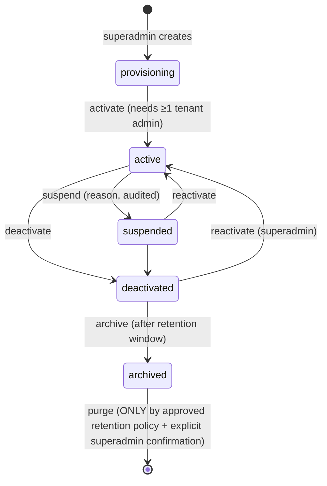

# 02 — Multi-Tenant Business Model

Status: PROPOSED (not approved). Items marked [U] have a default but need your answer.

## 1. Baseline

One platform · many organizations (tenants) · isolated tenant data · one platform-level superadmin capability · tenant administrators · one web portal (superadmin + tenant admins) · one mobile app (crew) · one Laravel API.

**Tenant = a manning agency** (today: `client_code = SFAI`, "Southfield Agencies, INC"). [I from `client_code` in registration/headers; D-3]

## 2. Actors

| Actor | Identity | Primary client | Scope |
|---|---|---|---|
| Superadmin | `platform_admins` (separate table, separate guard) | Web | Platform-wide; never a tenant member by virtue of being superadmin |
| Tenant administrator | `users` + membership role `tenant_admin` | Web | One tenant per membership |
| Tenant staff roles [U D-5] | `users` + membership role (e.g. document reviewer, payroll officer) | Web | Tenant; proposed, only if you confirm |
| Crew (seafarer) | `users` + membership role `crew` | Mobile | Own records within one tenant |

## 3. Organization lifecycle

| Transition | Effect (default) |
|---|---|
| Create | Tenant row, default settings, **no users**; superadmin invites first tenant admin (email invite; no password chosen by superadmin). |
| Activate | Members can authenticate. |
| Suspend | All tenant-user tokens/sessions rejected with `403 tenant_suspended`; data untouched; superadmin retains read access via platform endpoints; jobs for tenant paused. [U D-8: alternative "read-only for crew"]. |
| Deactivate | Same as suspend but intended long-term; exports allowed to tenant admin only if D-8/D-9 say so. |
| Archive | Tenant data frozen, files moved to cold storage class if available; unreachable by any tenant user. |
| Purge | **Not implemented** until a retention policy is approved (D-9). Soft state only; hard delete requires explicit approval, backup verified, audit record. |

All transitions write `audit_logs` and revoke affected sessions/tokens immediately (suspend/deactivate).

## 4. User membership

- **Identity vs membership are separate.** `users` = one login identity (username/email/password). `memberships` = (user, tenant, role, status). Authorization always evaluates the membership, never a global role on the user. [P]
- Default [U D-4/D-5]: a crew user has **one** membership; the schema allows many so a second agency never requires a migration.
- Different roles in different tenants: supported by design (role is on the membership).
- Tenant admins can invite/create users **in their own tenant only**, assign roles from the set a tenant admin is allowed to grant (never `superadmin`, never cross-tenant).
- Superadmin accounts are **not** memberships and live in `platform_admins` with their own credentials and mandatory MFA.
- Switching organizations (only when a user has >1 active membership): server-side operation that issues a **new** token/session bound to the other membership (§6).
- Registration (mobile, from the spec): self-registration creates `user` + `membership(status=pending)` in the tenant identified by an agency code; membership is unusable until a tenant admin activates it (BR-02).

## 5. Settings layering

| Layer | Examples | Stored | Override rule |
|---|---|---|---|
| Platform | password minimums, allowed upload size ceiling, token TTLs, maintenance flag | `platform_settings` | Code defaults < platform settings |
| Tenant | display name, logo, payslip header/footer text, privacy-policy URL, module entitlements (see §10), payslip step-up mode (Q-10), upload size (≤ platform ceiling) | `tenant_settings` | Platform ≤ tenant, tenant may only tighten security-related settings |
| User | none required by spec (UI prefs live on device) | — | — |
| Device | none server-side; token row records device name/last used | `personal_access_tokens` | — |

Resolution order: `tenant_settings` → `platform_settings` → code default. Typed registry in code (no free-form keys) so unknown settings are rejected. [P]

## 6. Tenant resolution and context

Principle: **the client never asserts a tenant; the server derives it from an authenticated credential and re-validates membership on every request.**

| Client | How tenant is established |
|---|---|
| Mobile | Login with username/password (+ optional agency code, D-4). Server finds active memberships. One → token issued **bound to that `membership_id`** (stored on the token row). Several → `409`-style response with a short-lived selection ticket + list; client posts the chosen membership with the ticket; server issues the bound token. Tenant is never in a header the server trusts. |
| Web (tenant admin) | Cookie session. Session stores `membership_id` chosen at login (picker if several). Same validation each request. |
| Web (superadmin) | Separate guard/session. Platform routes live under `/api/v1/platform/*`. Acting on a tenant's data is done through explicit platform endpoints (`/platform/tenants/{tenant}/…`), audited — **no impersonation header**. |
| Background jobs | Job payload carries `tenant_id`; job middleware sets context and **fails closed** if missing. |

Optional hints: a client may send `X-Tenant-Hint` for UX/diagnostics only; middleware compares it with the token's tenant and **rejects mismatches (`409 tenant_mismatch`)**; it is never used to select data.

Domain model: single web host (e.g. `portal.<domain>`); **no per-tenant subdomains or custom domains required** (no evidence). A cosmetic route prefix (`/t/{slug}`) may exist in the SPA but is validated against the session, never trusted. [P]

## 7. Tenant data ownership

Everything the crew module touches is tenant-owned (announcements, crew profiles, documents, to-dos, payslips, loans, files, settings, audit rows). Global/reference data: platform settings, optionally default document-type templates [U G-04].

## 8. Deletion & retention

- No tenant/user/financial record is hard-deleted by default; soft delete + status.
- Crew "delete account" (Q-3): proposed = deactivate membership, anonymize profile PII, revoke tokens; payroll/loan records retained per retention policy (needs counsel/D-9). Until answered, the endpoint exists as a *request* that notifies tenant admin and returns `202`.
- Retention periods: **unknown — not invented.**

## 9. Open items for this document
D-3 tenant definition · D-4 username scope · D-5 staff roles · D-8 suspension behaviour · D-9 retention · G-04 document-type ownership · G-03 announcement audience.

## 10. Module entitlements and external-account links (M1, Tala-only MVP)
- **Entitlement is a platform decision.** The superadmin provisions a module for an organization and maps it to exactly one team of the external system (`tenant_modules.external_team_id`, unique across organizations). A tenant admin may only enable/disable a provisioned module; they cannot create entitlements or change the team.
- **Use** requires: tenant `active` ∧ module provisioned and enabled ∧ role ability `module.<code>.use` (`crew`, `tenant_admin`) ∧ a configured approved upstream endpoint. **Manage** (`module.<code>.manage`) is `tenant_admin` only.
- **Links** are per membership (one person, several organizations ⇒ one link each, pinned to that organization's team). An external account belongs to **one** Sailix user globally. Links are created by the gateway in M3.
- Suspending/deactivating the tenant or disabling the module stops gateway access on the very next request (checked per request, not cached in tokens).
