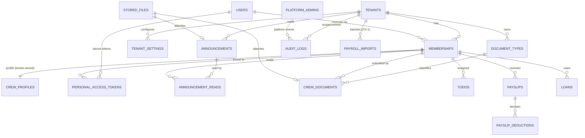

# 03 — Database and Tenant Isolation

Status: PROPOSED. Entities below come from the Flutter analysis; columns marked *(I)* are inferred producer-side needs (G-01) and need confirmation. No billing/subscription tables are proposed (no evidence).

## 1. Isolation strategy comparison

| Criterion | A. Shared DB + shared schema (`tenant_id`) | B. Schema per tenant | C. Database per tenant |
|---|---|---|---|
| Fit for expected scale (a handful to dozens of agencies, each thousands of crew) | Excellent | OK | Overkill |
| Ops (migrations, backups, pooling) | One migration, one backup | N migrations, search_path juggling, pooler friction | N migrations/backups/connections |
| Cross-tenant leak risk | Highest *if* done naively → mitigated by layered controls below | Lower | Lowest (hard boundary) |
| Per-tenant restore / export / purge | Harder (filtered) | Easy | Easiest |
| Superadmin cross-tenant reporting | Trivial | Awkward | Hard |
| Compliance-driven residency per tenant | No | No | Yes |
| Laravel ergonomics | Native | Needs tenancy package/hacks | Needs tenancy package |

**Recommendation: A (shared schema) with defence in depth**: global scopes + fail-closed context, composite tenant-aware foreign keys, UUIDv7 keys, static/schema checks in CI. **Revisit C** if a tenant requires contractual isolation, data residency, or per-tenant restore SLAs — none is evidenced today. Finalization is pending your answers on compliance/scale (D-6, D-9, D-11). ADR-0001.

**Engine (D-6 decided 2026-10-13): MySQL** (8.4+/9.x; developed against 9.7). InnoDB composite foreign keys, `json` columns, `utf8mb4_0900_ai_ci` collation. Consequences vs the PostgreSQL proposal: **no Row-Level Security** (one fewer independent wall — compensated in §3.6), no partial unique indexes (uniqueness that PostgreSQL would express as partial indexes is enforced in code/transactions), ids are `char(36)` UUIDv7. Usernames/emails/tenant codes are case-insensitively unique because of the collation.

## 2. Table catalogue

### Platform-level (no tenant_id)
| Table | Purpose |
|---|---|
| `platform_admins` | Superadmin identities (own credentials, MFA secret, status) |
| `tenants` | id, code (e.g. `SFAI`, unique), name, status, timestamps, archived_at |
| `platform_settings` | typed key/value |
| `users` | **login identity only**: username, email, password hash, status, last_login |
| `personal_access_tokens` | Sanctum + `membership_id`, `tenant_id`, device name, expires_at, last_used_at |
| `password_reset_tokens`, `sessions`, `cache`, `jobs`, `failed_jobs` | Laravel infrastructure (jobs carry tenant_id in payload; cache keys prefixed) |
| `audit_logs` | `tenant_id` **nullable** (platform events), actor type/id, action, subject, ip, user_agent, diff (redacted) |

### Tenant membership / config
| Table | Key columns |
|---|---|
| `memberships` | id, tenant_id, user_id, role, status (`pending/active/suspended`), unique(tenant_id,user_id) |
| `tenant_settings` | tenant_id, key, value (json), unique(tenant_id,key) |
| `crew_profiles` | tenant_id, membership_id, `crew_code` (the legacy `crewID`), first/middle/last/suffix, mobile, birth_date, email copy? — **PII lives here, tenant-owned** |

### Tenant-owned business tables (all carry `tenant_id`)
| Table | From (spec) | Notes |
|---|---|---|
| `announcements` | ANN-01..03 | title, body, attachment file ref, active/expiry, created_by *(I)* |
| `announcement_reads` | `isViewed`, `notificationID` | (announcement_id, membership_id, read_at); recipient targeting [U G-03] |
| `document_types` | `/pldocument` | name, short name; tenant-owned (seeded from defaults) [U G-04] |
| `crew_documents` | DOC-01/03/05/06 | one table with `status` (`pending`,`approved`,`rejected`,`superseded`); doc_type_id, number, grade, location, school, issued_on, expires_on, rejection_reason, reviewed_by/at *(I)*, file ref. Server-computed expiry state (`expired/expiring/none`) via query/accessor, rule thresholds [U Q-12] |
| `todos` | TODO-01/02 | membership_id, description, due_date, is_done, done_at, created_by *(I)* |
| `payslips` | FIN-02..04 | kind (`regular/special/final`), vessel_name, `date_pro`, period label, crew/position/address/payee, bank code/account (stored; masked in API), exchange_rate, pay_usd, pay_php, net_amount, is_dollar, sss/philhealth/pagibig, deductions_total; undisplayed legacy fields (`adjustment`, `union_dues`, `mpfee`, …) in `extra json` until Q-7 resolved |
| `payslip_deductions` | `deductions[]` | payslip_id, descr, amount |
| `loans` | FIN-05 | code, descr, loan_amount, deduct_amount, paid_amount, balance, is_dollar, flags in `extra` until Q-30 |
| `payroll_imports` *(I, D-1)* | – | batch id, source, status, row counts, errors; only if ingestion is chosen |
| `stored_files` | upload/attachments | tenant_id, disk, path (`tenants/{tenant_id}/…`), original name, mime (sniffed), size, sha256, owner (polymorphic), uploaded_by |
| `notifications` | email | Laravel notifications table + tenant_id (if in-app/email log needed) |

Money columns: `decimal(14,2)` (exchange rate `decimal(14,6)`); the API returns strings. Business rule BR-48 stays: totals are stored/received values, never recomputed on clients.

Not modelled (not evidenced): subscriptions/plans/billing; Tasks module; Call-It reports; ASTRA content (static, shipped in the app; feature flag only).

## 3. Ownership & constraint strategy

1. Every tenant-owned table has `tenant_id uuid NOT NULL` → `tenants.id`, indexed as the **leading** column of composite indexes.
2. Primary keys: `uuid` (v7) — non-guessable, removes sequential-ID enumeration as an IDOR aid. Public API only exposes these.
3. **Composite tenant-aware FKs**: parents declare `UNIQUE (tenant_id, id)`; children reference `(tenant_id, parent_id)`. A document in tenant A **cannot** reference a doc type, membership or file of tenant B — rejected by the database, not just by code.
   ```sql
   ALTER TABLE crew_documents
     ADD FOREIGN KEY (tenant_id, document_type_id) REFERENCES document_types (tenant_id, id),
     ADD FOREIGN KEY (tenant_id, membership_id)    REFERENCES memberships    (tenant_id, id);
   ```
4. Uniqueness scoped to tenant: `UNIQUE (tenant_id, crew_code)`, `UNIQUE (tenant_id, user_id)` on memberships, etc. (Global: `users.username`/`email` per D-4.)
5. Soft deletes only on user-visible business records; never on `audit_logs`.
6. **No RLS on MySQL — compensating controls (Phase B/C):** (a) fail-closed `TenantScope` (queries without a context throw), (b) composite `(tenant_id, id)` FKs reject cross-tenant links, (c) `TenancyStaticChecksTest` fails CI on scope bypass outside `app/Platform` + `app/Identity`, on raw `DB::table()` access to tenant tables, on tenant tables without a scoped model/FK/tenant-leading unique key, and on mass-assignable `tenant_id`, (d) the isolation suite runs on real MySQL, (e) production app credentials get DML only (no `DROP/ALTER`), and (f) any new raw SQL on tenant tables must go through a reviewed helper that adds the tenant predicate. Residual risk: a developer who writes raw SQL via `DB::select()`/`DB::statement()` is not caught by the static checks and would bypass the scope — code review must treat raw SQL on tenant tables as a security-sensitive change. If this risk is unacceptable, revisit database-per-tenant (ADR-0001).

## 4. Enforcement layers (how a missed filter is still safe)

| Layer | Control |
|---|---|
| AuthN | Token/session bound to `membership_id`; tenant derived server-side (see 04) |
| Middleware | `ResolveTenantContext`: loads membership, checks `membership.status=active` and `tenant.status=active`, sets immutable `TenantContext`; rejects spoofed hint; platform routes use a different middleware that **forbids** a tenant context |
| Models | `BelongsToTenant` trait: global scope `where tenant_id = ctx` that **throws** if no context (fail-closed); `creating` hook stamps `tenant_id` from context and rejects a conflicting value; `tenant_id` never mass-assignable |
| Authorization | Policies check `record.tenant_id === ctx.tenant_id` **and** role/ownership (crew sees own records: `membership_id`) |
| Query escape hatches | `withoutTenantScope()` allowed only in platform code paths; CI check greps/lints for its use outside `app/Platform/**` |
| Services/Actions | Take validated IDs only, load through scoped models; no raw `DB::table()` on tenant tables outside a reviewed helper that adds the tenant predicate |
| Files | Keys under `tenants/{tenant_id}/`; downloads go through an authorized controller (policy on `stored_files`) → streamed or **short-lived signed URL (≤5 min)** minted *after* the policy check; no public bucket |
| Exports/reports | Built from scoped queries inside a job carrying tenant_id; output file stored as tenant file; download authorized as above |
| Search | Database queries via scoped models; if an external search engine is added later, index per tenant with tenant filter enforced server-side (not planned) |
| Jobs / scheduler | `TenantAwareJob` middleware restores context, **fails if absent**; scheduled commands iterate tenants and dispatch one job per tenant; no job reads across tenants |
| Notifications | Notifiable resolved through scoped models; email links never embed tenant trust |
| Cache | Keys `t:{tenant_id}:…` via a helper; global keys explicitly named `g:`; no unscoped `Cache::remember` in tenant code (lint) |
| DB | Composite tenant-aware FKs, tenant-leading unique keys, schema-lint tests; production app user has DML rights only (no DDL). No row-level security on MySQL (see §3.6) |
| Observability | `tenant_id`, `membership_id`, `request_id` in log context; tenant id never taken from user input |

Tenant context is established once per request/job, immutable, exposed via a request-scoped singleton, and propagated into queued jobs/notifications explicitly (serialised `tenant_id`, re-validated on run: tenant must still be `active`).

## 5. Initial ER diagram


(`tenant_id` on every tenant-owned table not drawn for readability.)

## 6. Migration policy
Laravel migrations only; forward-only in staging/prod; dev DB only until approval; no destructive migration without verified backup + approval; schema-lint test (Phase C) fails CI if a table with `tenant_id` lacks the composite index/FK pattern or a tenant-owned model lacks `BelongsToTenant`.

## 7. M1 additions — module tables
| Table | Scope | Key constraints |
|---|---|---|
| `tenant_modules` | tenant-owned (`BelongsToTenant`) | `unique(tenant_id, module)`; `unique(tenant_id, id)`; `unique(tenant_id, module, external_team_id)` (FK parent); **`unique(module, external_team_id)`** — one external team per organization (NULL rows exempt); `external_team_id` is `utf8mb4_bin` |
| `external_identities` | **identity-level, no `tenant_id`** (reviewed exception, ADR-0017) | **`unique(module, external_user_id)`** (one external account per Sailix user, any tenant); `unique(user_id, module)`; case-sensitive id |
| `module_links` | tenant-owned | `unique(tenant_id, membership_id, module)`; composite FK `(tenant_id, membership_id)` → memberships; composite FK `(tenant_id, module, external_team_id)` → `tenant_modules` (**a link can only use its own organization's mapped team**; the mapping cannot change while links exist); tokens encrypted by cast, hidden from serialization, nullable until M3 |

`TenancyStaticChecksTest` now also asserts the exact set of tables **without** `tenant_id` (each justified), so a new un-scoped table is a conscious, reviewed decision, and that it inspects only the connected database (it previously also saw the dev schema).
