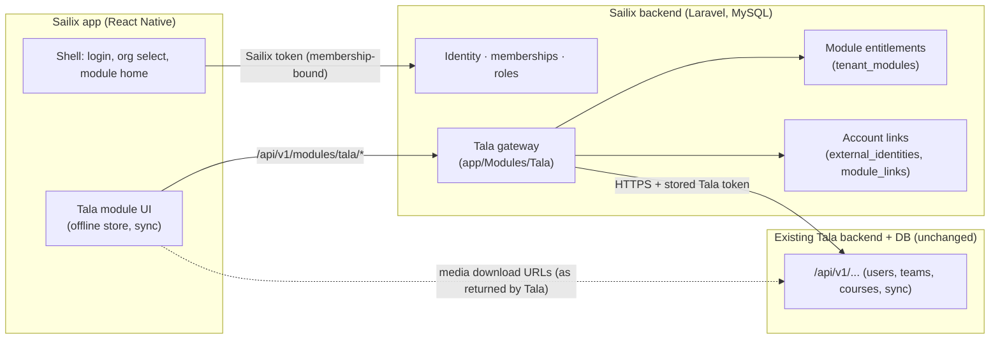

# 13 — Tala-only MVP: scope, impact on Phase B, revised roadmap

Status: **PROPOSED — awaiting your approval. No code has been changed for this scope change.** Supersedes the Phase C–I ordering and the Phase D module list in `12-MASTER-IMPLEMENTATION-PLAN.md` (Phases A and B stand as completed).
Evidence: read-only analysis of the Tala Flutter working tree in `docs/reference/tala-analysis/` (`01` identity, `02` courses/content, `03` stats/offline/platform). Citations below are to those files. **[V]** verified in Tala source · **[I]** inferred · **[P]** proposed · **[U]** unknown, needs the Tala backend owner.

## 1. What changes

| Before (approved plan) | Now |
|---|---|
| Sailix = crew portal (announcements, documents, to-dos, payslips) + deferred "Services" | Sailix = **host app + identity/organization platform**. First module: **Tala (LMS)** |
| Phase D modules D2–D7 = Sailix crew features | **Deferred (post-MVP)** — design kept, nothing deleted (needs your confirmation, Q-S1) |
| One new Laravel backend owns all business data | Sailix backend owns **identity, organizations, roles, module access, account links**. **Tala data stays in the existing Tala backend/DB** and is reached through a Sailix gateway |
| SRT, Call-it, Astra | **Not integrated.** Architecture only stays extensible (module registry) |

Unchanged and preserved: one Sailix account per person · individual users · multiple organizations · organization-specific roles (memberships) · secure account linking · superadmin vs tenant-admin separation · fail-closed tenancy · everything built in Phase B.

## 2. Verified facts about Tala that drive the design

| # | Fact | Source |
|---|---|---|
| F1 | Single live host `tala-v3-server.btsolve.com`; a dev (Elastic Beanstalk) host and a LAN address are declared but unused; **every call is plain `http://`** and no cleartext exemption was found, so production transport is unknown | 01 §1, 02 §2 |
| F2 | Login `POST /api/v1/login` `{username,password}` → `accessToken, refreshToken, userId`. All later calls: `Authorization: Bearer <accessToken>`. **No refresh endpoint is used**, no expiry handling | 01 §2 |
| F3 | Every data call is scoped by `userId` **and `teamId` in the URL path** (`/users/{userId}/teams/{teamId}/courses…`); whether the server checks them against the token is unknown (possible IDOR) | 01 §2, §10 |
| F4 | Organizations = **teams**. A user can belong to several; joining = `POST …/teams/apply {teamCode}` → pending admin approval **[I]**. No roles/userType in the client; Tala admin lives in a separate admin app | 01 §3 |
| F5 | Tala registration is email-activated; forgot-password probably emails a generated password **[I]**; delete-account exists; Flutter reports success even if the server call fails | 01 §4–6 |
| F6 | Content: courses (assign + apply by `courseCode`), materials = video (+mandatory rating/comment), PDF, flashcards (EASY/MEDIUM/HARD), quizzes (`UP_QUIZ` new, `QUIZ` legacy), EPUB (**no reader exists** — tapping just marks complete). 11 JSON endpoints + 3 binary file URLs | 02 §1–2 |
| F7 | **Scoring is entirely client-side**; the server ships answer keys; results are pushed in one full-snapshot `POST …/courses/sync {courseList}`; restore via `GET …/courses/{id}/sync/{assignId}/data` | 02 §4, 03 §3 |
| F8 | Content can only be opened after **download**; offline store = sqflite, 12 tables, all TEXT, **no keys/indexes** (duplicates possible); sync is manual only, no retry/queue | 02 §5, 03 §2–3 |
| F9 | Media URLs are absolute (CloudFront), unauthenticated; downloads send no auth | 02 §2, §7 |
| F10 | Plaintext token/PII in SharedPreferences; logout does not wipe the DB | 01 §9, 03 §7 |

## 3. Tala MVP scope

### 3.1 Features (dispositions as required: KEEP / IMPROVE / REMOVE / PENDING)

| Tala feature | MVP | Disposition | Notes |
|---|---|---|---|
| Login / session | via **Sailix** login + account link | IMPROVE | Tala credentials never become the app login; see §4 |
| Register Tala account | **No** (link existing account) | PENDING (D-T3) | Writing users to the production Tala DB needs your approval; later task |
| Forgot / change Tala password | **No** | REMOVE from MVP | Done in Sailix for Sailix accounts; Tala password changes stay with Tala |
| Delete Tala account | **No** | PENDING | Sailix deletion request (Q-3) is separate |
| Team selection / switch | Replaced by **tenant ↔ team mapping** | IMPROVE | No team picker in the Tala module |
| Join team by code | Admin-assisted in link flow | PENDING (D-T7) | |
| Course list + detail + days-left | **Yes** | KEEP/IMPROVE | 4-state UI, expired styling |
| Apply for course by code | **Yes** | KEEP | Pending-approval state shown (Flutter has none) |
| Video (+ rating & comment gate) | **Yes** | KEEP | Completion = feedback submitted (F6) |
| PDF | **Yes** | KEEP | Completion on open (as Flutter) |
| Flashcards | **Yes** | KEEP/IMPROVE | Fix unawaited-write race and "NOT SEEN" mismatch (03 §8) |
| New quiz `UP_QUIZ` | **Yes** | KEEP/IMPROVE | Fix checkbox scoring, empty-quiz NaN, pass-mark parse |
| Legacy quiz `QUIZ` | **Only if production still has such courses** | PENDING (D-T6) | Flutter shows it empty offline |
| EPUB | **No** | PENDING (D-T6) | No working reference; needs a reader decision |
| Download for offline + delete | **Yes** | KEEP/IMPROVE | Delete must remove files too |
| Offline study + unsynced indicator | **Yes** | IMPROVE | |
| My Stats + manual/on-reconnect sync | **Yes** | KEEP/IMPROVE | Computation stays client-side in MVP (F7) |
| Forms tab, promo code, feedback, ATT prompt | **No** | REMOVE | Stubs/unfinished (01 §7) |

### 3.2 Sailix platform features required **only** for Tala
Sailix registration (agency code → pending → admin activation) · login + organization selection · password reset/change · deletion request · organization management (platform) · member administration (tenant) · **module entitlement** (is Tala on for this organization) · **account linking** · tenant ↔ Tala-team mapping · audit.

### 3.3 Explicitly deferred
SRT, Call-it, Astra · Sailix crew portal modules (announcements, documents, to-dos, finance, dashboard) · Tala course authoring/admin (stays in Tala's own admin app) · EPUB, Forms · push notifications · server-side score verification · SSO token-exchange with Tala (target state, needs a Tala backend change) · Sailix-owned file storage.

## 4. Architecture delta

**Pattern (ADR-0018): Sailix gateway, not direct client→Tala.** The app never holds a Tala password or token. The gateway authorizes (Sailix token → membership → tenant active → module enabled → role ability → link exists), then calls Tala server-side with the stored Tala token. Reasons: org suspension and role changes take effect immediately; one credential on the device; Tala's path-scoped IDOR risk (F3) cannot be exploited by a user editing IDs (the gateway fixes `userId`/`teamId` from the link, never from the request); transport can be HTTPS-enforced server-side even while the mobile side stays simple. Cost: ~12 thin endpoints and coupling to Tala availability. **Rejected:** direct client calls (credentials + plaintext HTTP on device, no tenant control); copying Tala data into Sailix (contradicts "reuse existing backend and database", large migration, production data risk).

**Module registry (ADR-0016).** Code-defined `Module` enum (`tala` only) + `tenant_modules` rows (tenant, module, status, config). Access = tenant active ∧ module enabled ∧ role ability `module.tala.use` ∧ (for data) link `linked`. Adding SRT/Call-it/Astra later = a new enum case, abilities, `app/Modules/<X>` adapter and a mobile feature folder. **No generic plugin framework and no abstract interfaces until a second module exists** (avoids speculative abstraction).

**Account linking (ADR-0017).**
- Two tables: `external_identities` (identity-level: Sailix user ↔ `(module, external_user_id)`, globally unique so one Tala account cannot be claimed by two Sailix users) and `module_links` (tenant-owned: membership ↔ identity, `external_team_id`, encrypted tokens, status `linked / needs_relink / revoked`). One person, several organizations ⇒ one link per membership, each pinned to that organization's Tala team.
- Link flow: user (logged in to Sailix, membership active, module enabled) enters Tala username+password **once** → gateway calls Tala login → gets `userId` + tokens → lists the user's teams → requires the organization's mapped `teamId` among them (otherwise tells the user to apply/ask admin) → stores **tokens only, encrypted**; the password is never stored or logged.
- Default credential policy (D-T4): tokens only; if Tala rejects the token (expiry/revocation) the link becomes `needs_relink` and the user re-enters the password. Alternatives: store the password encrypted (convenient, higher custody risk) or, target state, a Tala-side token-exchange/SSO endpoint (requires a change to the Tala backend — **not** made by this project without your approval).
- Unlink on membership suspension/removal and tenant deactivation; relink revokes the old tokens locally.

**Organization-specific roles.** Unchanged (memberships). Tala has no roles (F4); Sailix roles gate *module access*: `crew` and `tenant_admin` get `module.tala.use`; `tenant_admin` gets `module.tala.manage` (enable, map team, view link status, force unlink). Course authoring stays in Tala's own admin app.

**Offline (Tala module).** `expo-sqlite` with **real primary/unique keys** per (assignment, user, team, course, material), scoped by Sailix user+membership; downloads in the app sandbox excluded from backup; full-snapshot upload of COMPLETED items as Tala expects (F7) via the gateway, manual + on reconnect, retry with backoff, awaited transactional writes; logout/401/tenant-suspended wipes the store (warn about unsynced data first). Quiz answer keys on device are a known exposure inherited from Tala's design (F7) — documented, not solved in MVP.

## 5. Impact review of completed Phase B deliverables

Principle: **no redesign.** Phase B's identity, membership, token, tenancy and lifecycle model already supports the new scope. Only the following change, each with a reason.

| Deliverable | Change | Reason | Risk |
|---|---|---|---|
| `SettingsRegistry` `services_enabled`; `/me.features.services_enabled`; OpenAPI `Me.features`; tests | **Remove**, replaced by `/me.modules[]` | That flag meant Sailix "Services" (ASTRA/Call-It), now deferred; module entitlements supersede it. API is unreleased (v0.1.0, no clients) so no compatibility cost | Low |
| `Role` ability map | Add `module.tala.use` (crew, tenant_admin) and `module.tala.manage` (tenant_admin) | Module-level authorization | Low |
| New tables + models | `tenant_modules`, `external_identities`, `module_links` (+ `BelongsToTenant` on the two tenant-owned ones) | Entitlement + linking | Low; covered by schema-lint + isolation tests |
| `TenancyStaticChecksTest` | Exempt list gains `external_identities` (identity-level, justified in ADR-0017); new tables verified | Lint must stay meaningful | Low |
| Platform settings | Add platform-only `tala_api_base_url` (https enforced, host validated) | Prevents tenants pointing the gateway at arbitrary hosts (SSRF); one place to change environments | Low |
| `/me` + OpenAPI + contract tests | `modules[]` added | Mobile shell needs it | Low |
| Audit actions | `module.enabled/disabled`, `module.team_mapped`, `link.created/relinked/revoked` (no secrets) | Traceability | Low |
| Phase C scope | Slimmed: keep isolation tests for the new tables and tenant-keyed cache; **defer** `FileStore` (no Sailix-owned files) and `TenantAwareJob` (no jobs yet) until first use | YAGNI; nothing in the Tala MVP needs them | Low; tracked in plan |
| Docs 02–05, 08, 09, 10, 11 | Delta notes + new rows (module entitlements, linking, gateway threats: credential custody, SSRF, confused deputy, token replay, cross-tenant link hijack, plaintext-HTTP upstream) | Keep docs truthful | None |
| Docs 12 (plan) | Pointer: roadmap superseded by this document | | None |
| `mobile/` M0 | Kept as shell foundation; Sailix-crew screens not built; Tala module added under `src/features/modules/tala` | Reuse | Low |
| Phase D1 (identity) | Kept but trimmed to Tala needs (§3.2) | | – |
| Phase D2–D7, E, F | Re-scoped (see roadmap) | | – |

Not affected: tenant lifecycle, tokens bound to membership, platform/tenant guards, TOTP, invitations, CORS, rate limits, problem+json, contract tooling, CI, local MySQL tooling.

## 6. Revised roadmap

Dependencies are explicit; nothing starts without its gate. "Done" = acceptance criteria met and checks executed with results recorded in `PROJECT-STATUS.md`.

| Phase | Name | Depends on | Deliverables | Acceptance (summary) |
|---|---|---|---|---|
| A, B | Foundation, backend foundation | — | **Complete** (commits `f3fdce0`, `7feb811`) | 108 tests, Pint, PHPStan 6, OpenAPI valid |
| **M1** | **Module entitlements + link foundation** (first task, §7) | B | Tables, registry, abilities, `/me.modules`, tenant module endpoints, Tala base-URL setting, isolation + contract tests, ADR/doc updates | §7 |
| **T0** | **Tala API verification spike** (parallel to M1) | **Your approval + a non-production Tala environment/test account (D-T1)** | Read-only scripted calls (login, teams, courses, each material GET, sync-data); recorded sanitized fixtures; answers to F1–F3 and the open questions; `docs/14-TALA-INTEGRATION-CONTRACT.md` | HTTPS status known; token lifetime/refresh known; path-vs-token authorization known; fixtures committed (no real PII/tokens) |
| M2 | Identity completion for MVP | M1; D-11 (email) for real mail | Register with agency code → pending → activation; password reset/change; deletion request; web login screens' API needs | Feature + isolation + contract tests; no account enumeration; throttles |
| M3 | Tala gateway | M1, T0 | `TalaClient` (HTTPS-only, allow-listed host, timeouts, bounded retries, error mapping, redaction), link/relink/unlink, team resolution, read endpoints (courses, apply, material details, sync-data), sync push; token custody (encrypted) | Contract tests against recorded fixtures with HTTP faked; **zero calls to production**; foreign-tenant/foreign-user denial; token never in logs/responses |
| M4 | Web portal (trimmed) | M1 (+M2 for users) | Platform: tenants, lifecycle, invites, Tala base URL, audit. Tenant: members (approve/suspend/role), **Tala module** (enable, team mapping, link status, force unlink), audit. No course authoring | Role-matrix + Playwright flows; tenant admin cannot reach platform |
| M5 | Mobile: shell + Tala module | M2, M3 (T1 may start once M3 read endpoints exist) | **T1** link flow, course list/apply/detail, PDF, video (+feedback) · **T2** flashcards, `UP_QUIZ` · **T3** download/offline store, My Stats, sync, unsynced UX; shell: login, org select, module home | tsc/lint/jest; device-verified video/PDF/flashcard media; session/offline wipe tests. Spike S2 (PDF viewer) still applies; add a short video/audio playback spike (expo media modules, verify at install); S1 scanner and S3 audio-loop are **not needed** |
| M6 | Integration & hardening | M3–M5 | E2E against a Tala **dev** environment; security review (credential custody, SSRF, replay); accessibility; store identity/signing (Q-22); backup/restore drill; runbooks; **HTTPS-to-Tala gate** | All E2E green; HTTPS confirmed; Tala owner sign-off; no production change without your approval |
| Later (not in MVP) | SRT, Call-it, Astra, Sailix crew modules (old D2–D7), EPUB/Forms, Tala registration inside Sailix (D-T3), SSO token exchange, server-side score verification, push | — | Re-planned when approved | — |

Estimates are omitted (no velocity data). Ordering is by dependency; M1 and T0 can run in parallel, M2/M3 next, M4 and M5 can overlap once M3's read endpoints exist.

## 7. Proposed first implementation task — M1 "Module entitlements and account-link foundation"

**Scope:** backend + contract + docs only. No Tala network calls, no mobile/web UI, no Tala code. Smallest slice that makes every later phase possible and removes the obsolete flag.

**Deliverables**
1. Migration(s): `tenant_modules`, `external_identities`, `module_links` (columns in ADR-0016/0017), composite tenant-aware FKs, tenant-leading unique keys, token columns encrypted-cast (nullable until M3).
2. `App\Modules\Module` enum (`Tala`) + registry helpers; Tala-specific code lives only under `app/Modules/Tala`.
3. Abilities `module.tala.use`, `module.tala.manage` in the role map; `RequireModule` middleware (`module_disabled`, `module_forbidden`).
4. Endpoints (OpenAPI first): `GET /tenant/modules`, `PUT /tenant/modules/tala` (enable/disable + `tala_team_id`), `/me` gains `modules[]`; platform setting `tala_api_base_url`.
5. Removal of `services_enabled` (setting, `/me.features`, OpenAPI, tests).
6. Audit entries; ADRs 0015–0018 status → accepted on approval; docs 02/03/04/05/08/09 deltas; `PROJECT-STATUS.md`.

**Acceptance criteria (each is a test or a command, run and recorded)**
1. `php artisan migrate:fresh` succeeds on MySQL; schema-lint tests pass with the new tables (scoped model, tenant FK, tenant-leading uniques); `external_identities` exemption is explicit and justified in the test.
2. A `module_links` row cannot reference another tenant's membership (composite FK, tested); `(tenant_id, membership_id, module)` is unique; `(module, external_user_id)` is unique across all users (a second Sailix user cannot claim the same external account — tested).
3. Role matrix: `crew` and `tenant_admin` pass `module.tala.use`; only `tenant_admin` passes `module.tala.manage`; no role grants platform abilities (existing test still passes).
4. `RequireModule:tala` returns `403 module_disabled` when the tenant module is off or the tenant is not active, `403 module_forbidden` for a role without the ability, and passes otherwise (tested on a test-only route).
5. `PUT /tenant/modules/tala`: `tenant_admin` only; validates `tala_team_id`; enabling/disabling and mapping are audited without secrets; tenant A cannot read or modify tenant B's module rows (isolation tests, including guessed ids ⇒ 404).
6. `/me.modules[]` returns `{code, enabled, linked, status}` per module for the caller's membership; `features.services_enabled` and the `services_enabled` setting no longer exist anywhere (grep-verified).
7. `tala_api_base_url` is settable only via `/platform/settings`, only as `https://` host (rejects `http://`, IP literals, `localhost` outside local/testing); tenant PATCH of it ⇒ 422 unknown setting.
8. `contracts/openapi.yaml` updated first; contract tests (including the guard-the-guard test) and `redocly lint` pass.
9. Gates executed and recorded: Pint, PHPStan level 6 = 0 errors, full test suite (all suites) green with **count ≥ 108 + new tests**, `composer audit` clean, fresh-clone reproduction.
10. Constraints verified: no outbound network call added; `git -C ../tala3 status --short | wc -l` still 45; no changes outside `sailix_v2`; no production data or migration touched.

## 8. Decisions and questions for you

| ID | Question | Default if unanswered |
|---|---|---|
| **D-T1** | May I run **read-only** verification calls (login, teams, courses, material GETs) against a **non-production** Tala environment, and can you supply a test account? Which environment (the Elastic Beanstalk dev host found in the code, or another)? | **No Tala calls are made.** M3 would be built on fixtures derived from source analysis only and flagged unverified |
| **D-T2** | Does the production Tala API serve **HTTPS**? (Flutter uses `http://`.) | Gateway enforces HTTPS-only; production cutover blocked until confirmed |
| D-T3 | Allow creating **new Tala accounts** from inside Sailix (calls Tala's public register endpoint)? | No — link existing accounts only |
| D-T4 | Credential policy for links: tokens only + re-link (default) · store password encrypted · ask Tala owner for an SSO/token-exchange endpoint | Tokens only + re-link |
| D-T5 | Tala's refresh-token flow: does an endpoint exist? Token lifetime? (cannot be derived from the Flutter app) | Treat as unknown; `needs_relink` on 401 |
| D-T6 | Do production courses still contain legacy `QUIZ` items or EPUBs? | `UP_QUIZ`, video, PDF, flashcards only |
| D-T7 | Tenant ↔ Tala team: one team per organization, mapped by the tenant admin; who approves Tala team membership (Tala admin)? | 1:1 mapping; users must already be members of that team |
| D-T8 | Client-computed quiz/flashcard scores are trusted (as in Tala today). Accept for MVP? | Accept, document risk |
| Q-S1 | **Confirm** the Sailix crew portal features (announcements, documents, to-dos, payslips) are deferred out of the MVP | Deferred |
| D-11 | Email provider (needed for activation/reset in M2) | Log driver locally; M2 real-mail blocked |
| Q-22 | Store identity for the host app (`com.btsolve.sailix2` vs new) | Keep `com.btsolve.sailix2` |

## 9. Key risks

1. **Tala transport and authorization unknowns** (F1–F3) — mitigated by T0, gateway fixing `userId/teamId`, HTTPS-only client; production gate in M6.
2. **Credential custody** — tokens only, encrypted, never logged/returned; relink on failure; threat model updated (docs/09).
3. **Gateway coupling** — Tala outage ⇒ module outage; cached course list on device covers read-only offline use; timeouts and clear errors.
4. **Offline/sync correctness** — Tala's design has races and no keys (03 §8); mitigated by a new keyed store, awaited transactional writes, replace-by-snapshot semantics identical to Tala's contract; **server merge/idempotency unknown (T0)**.
5. **Client-trusted scoring and on-device answer keys** — inherited; documented; server-side verification deferred.
6. **Scope creep** back to Sailix crew modules or Tala account creation — held behind explicit approvals.
7. **No RLS on MySQL** (Phase B residual) applies equally to the new tables; static checks extended.
