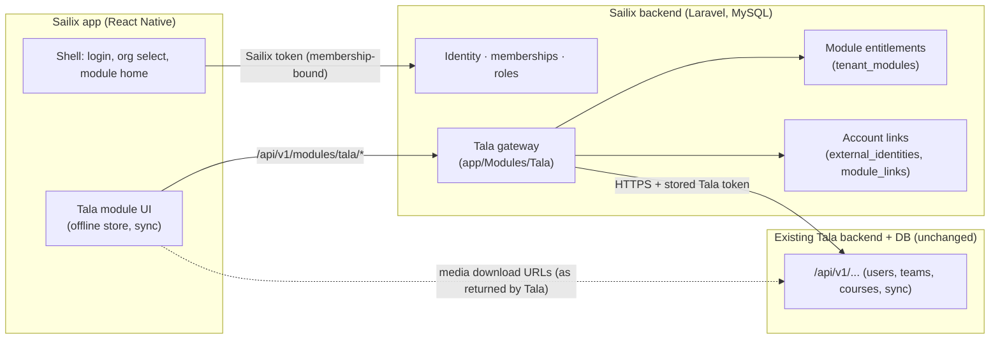

# 13 — Tala-only MVP: scope, impact on Phase B, revised roadmap

Status: **APPROVED 2026-10-13 with conditions (§10). M1 done (§11); M2 done (§12); M4 implemented and awaiting your review (§13).** Supersedes the Phase C–I ordering and the Phase D module list in `12-MASTER-IMPLEMENTATION-PLAN.md` (Phases A and B stand as completed).
Evidence: read-only analysis of the Tala Flutter working tree in `docs/reference/tala-analysis/` (`01` identity, `02` courses/content, `03` stats/offline/platform). Citations below are to those files. **[V]** verified in Tala source · **[I]** inferred · **[P]** proposed · **[U]** unknown, needs the Tala backend owner.

## 1. What changes

| Before (approved plan) | Now |
|---|---|
| Sailix = crew portal (announcements, documents, to-dos, payslips) + deferred "Services" | Sailix = **host app + identity/organization platform**. First module: **Tala (LMS)** |
| Phase D modules D2–D7 = Sailix crew features | **Deferred (post-MVP)** — design kept, nothing deleted (needs your confirmation, Q-S1) |
| One new Laravel backend owns all business data | Sailix backend owns **identity, organizations, roles, module access, account links**. **Tala data stays in the existing Tala backend/DB** and is reached through a Sailix gateway |
| SRT, Call-it, Astra | **Not integrated.** Architecture only stays extensible (module registry) |

Unchanged and preserved: one Sailix account per person · individual users · multiple organizations · organization-specific roles (memberships) · secure account linking · superadmin vs tenant-admin separation · fail-closed tenancy · everything built in Phase B.

## 2. Verified facts about Tala that drive the design

| # | Fact | Source |
|---|---|---|
| F1 | Single live host `tala-v3-server.btsolve.com`; a dev (Elastic Beanstalk) host and a LAN address are declared but unused; **every call is plain `http://`** and no cleartext exemption was found, so production transport is unknown | 01 §1, 02 §2 |
| F2 | Login `POST /api/v1/login` `{username,password}` → `accessToken, refreshToken, userId`. All later calls: `Authorization: Bearer <accessToken>`. **No refresh endpoint is used**, no expiry handling | 01 §2 |
| F3 | Every data call is scoped by `userId` **and `teamId` in the URL path** (`/users/{userId}/teams/{teamId}/courses…`); whether the server checks them against the token is unknown (possible IDOR) | 01 §2, §10 |
| F4 | Organizations = **teams**. A user can belong to several; joining = `POST …/teams/apply {teamCode}` → pending admin approval **[I]**. No roles/userType in the client; Tala admin lives in a separate admin app | 01 §3 |
| F5 | Tala registration is email-activated; forgot-password probably emails a generated password **[I]**; delete-account exists; Flutter reports success even if the server call fails | 01 §4–6 |
| F6 | Content: courses (assign + apply by `courseCode`), materials = video (+mandatory rating/comment), PDF, flashcards (EASY/MEDIUM/HARD), quizzes (`UP_QUIZ` new, `QUIZ` legacy), EPUB (**no reader exists** — tapping just marks complete). 11 JSON endpoints + 3 binary file URLs | 02 §1–2 |
| F7 | **Scoring is entirely client-side**; the server ships answer keys; results are pushed in one full-snapshot `POST …/courses/sync {courseList}`; restore via `GET …/courses/{id}/sync/{assignId}/data` | 02 §4, 03 §3 |
| F8 | Content can only be opened after **download**; offline store = sqflite, 12 tables, all TEXT, **no keys/indexes** (duplicates possible); sync is manual only, no retry/queue | 02 §5, 03 §2–3 |
| F9 | Media URLs are absolute (CloudFront), unauthenticated; downloads send no auth | 02 §2, §7 |
| F10 | Plaintext token/PII in SharedPreferences; logout does not wipe the DB | 01 §9, 03 §7 |

## 3. Tala MVP scope

### 3.1 Features (dispositions as required: KEEP / IMPROVE / REMOVE / PENDING)

| Tala feature | MVP | Disposition | Notes |
|---|---|---|---|
| Login / session | via **Sailix** login + account link | IMPROVE | Tala credentials never become the app login; see §4 |
| Register Tala account | **No** (link existing account) | PENDING (D-T3) | Writing users to the production Tala DB needs your approval; later task |
| Forgot / change Tala password | **No** | REMOVE from MVP | Done in Sailix for Sailix accounts; Tala password changes stay with Tala |
| Delete Tala account | **No** | PENDING | Sailix deletion request (Q-3) is separate |
| Team selection / switch | Replaced by **tenant ↔ team mapping** | IMPROVE | No team picker in the Tala module |
| Join team by code | Admin-assisted in link flow | PENDING (D-T7) | |
| Course list + detail + days-left | **Yes** | KEEP/IMPROVE | 4-state UI, expired styling |
| Apply for course by code | **Yes** | KEEP | Pending-approval state shown (Flutter has none) |
| Video (+ rating & comment gate) | **Yes** | KEEP | Completion = feedback submitted (F6) |
| PDF | **Yes** | KEEP | Completion on open (as Flutter) |
| Flashcards | **Yes** | KEEP/IMPROVE | Fix unawaited-write race and "NOT SEEN" mismatch (03 §8) |
| New quiz `UP_QUIZ` | **Yes** | KEEP/IMPROVE | Fix checkbox scoring, empty-quiz NaN, pass-mark parse |
| Legacy quiz `QUIZ` | **Only if production still has such courses** | PENDING (D-T6) | Flutter shows it empty offline |
| EPUB | **No** | PENDING (D-T6) | No working reference; needs a reader decision |
| Download for offline + delete | **Yes** | KEEP/IMPROVE | Delete must remove files too |
| Offline study + unsynced indicator | **Yes** | IMPROVE | |
| My Stats + manual/on-reconnect sync | **Yes** | KEEP/IMPROVE | Computation stays client-side in MVP (F7) |
| Forms tab, promo code, feedback, ATT prompt | **No** | REMOVE | Stubs/unfinished (01 §7) |

### 3.2 Sailix platform features required **only** for Tala
Sailix registration (agency code → pending → admin activation) · login + organization selection · password reset/change · deletion request · organization management (platform) · member administration (tenant) · **module entitlement** (is Tala on for this organization) · **account linking** · tenant ↔ Tala-team mapping · audit.

### 3.3 Explicitly deferred
SRT, Call-it, Astra · Sailix crew portal modules (announcements, documents, to-dos, finance, dashboard) · Tala course authoring/admin (stays in Tala's own admin app) · EPUB, Forms · push notifications · server-side score verification · SSO token-exchange with Tala (target state, needs a Tala backend change) · Sailix-owned file storage.

## 4. Architecture delta

**Pattern (ADR-0018): Sailix gateway, not direct client→Tala.** The app never holds a Tala password or token. The gateway authorizes (Sailix token → membership → tenant active → module enabled → role ability → link exists), then calls Tala server-side with the stored Tala token. Reasons: org suspension and role changes take effect immediately; one credential on the device; Tala's path-scoped IDOR risk (F3) cannot be exploited by a user editing IDs (the gateway fixes `userId`/`teamId` from the link, never from the request); transport can be HTTPS-enforced server-side even while the mobile side stays simple. Cost: ~12 thin endpoints and coupling to Tala availability. **Rejected:** direct client calls (credentials + plaintext HTTP on device, no tenant control); copying Tala data into Sailix (contradicts "reuse existing backend and database", large migration, production data risk).

**Module registry (ADR-0016).** Code-defined `Module` enum (`tala` only) + `tenant_modules` rows (tenant, module, status, config). Access = tenant active ∧ module enabled ∧ role ability `module.tala.use` ∧ (for data) link `linked`. Adding SRT/Call-it/Astra later = a new enum case, abilities, `app/Modules/<X>` adapter and a mobile feature folder. **No generic plugin framework and no abstract interfaces until a second module exists** (avoids speculative abstraction).

**Account linking (ADR-0017).**
- Two tables: `external_identities` (identity-level: Sailix user ↔ `(module, external_user_id)`, globally unique so one Tala account cannot be claimed by two Sailix users) and `module_links` (tenant-owned: membership ↔ identity, `external_team_id`, encrypted tokens, status `linked / needs_relink / revoked`). One person, several organizations ⇒ one link per membership, each pinned to that organization's Tala team.
- Link flow: user (logged in to Sailix, membership active, module enabled) enters Tala username+password **once** → gateway calls Tala login → gets `userId` + tokens → lists the user's teams → requires the organization's mapped `teamId` among them (otherwise tells the user to apply/ask admin) → stores **tokens only, encrypted**; the password is never stored or logged.
- Default credential policy (D-T4): tokens only; if Tala rejects the token (expiry/revocation) the link becomes `needs_relink` and the user re-enters the password. Alternatives: store the password encrypted (convenient, higher custody risk) or, target state, a Tala-side token-exchange/SSO endpoint (requires a change to the Tala backend — **not** made by this project without your approval).
- Unlink on membership suspension/removal and tenant deactivation; relink revokes the old tokens locally.

**Organization-specific roles.** Unchanged (memberships). Tala has no roles (F4); Sailix roles gate *module access*: `crew` and `tenant_admin` get `module.tala.use`; `tenant_admin` gets `module.tala.manage` (enable, map team, view link status, force unlink). Course authoring stays in Tala's own admin app.

**Offline (Tala module).** `expo-sqlite` with **real primary/unique keys** per (assignment, user, team, course, material), scoped by Sailix user+membership; downloads in the app sandbox excluded from backup; full-snapshot upload of COMPLETED items as Tala expects (F7) via the gateway, manual + on reconnect, retry with backoff, awaited transactional writes; logout/401/tenant-suspended wipes the store (warn about unsynced data first). Quiz answer keys on device are a known exposure inherited from Tala's design (F7) — documented, not solved in MVP.

## 5. Impact review of completed Phase B deliverables

Principle: **no redesign.** Phase B's identity, membership, token, tenancy and lifecycle model already supports the new scope. Only the following change, each with a reason.

| Deliverable | Change | Reason | Risk |
|---|---|---|---|
| `SettingsRegistry` `services_enabled`; `/me.features.services_enabled`; OpenAPI `Me.features`; tests | **Remove**, replaced by `/me.modules[]` | That flag meant Sailix "Services" (ASTRA/Call-It), now deferred; module entitlements supersede it. API is unreleased (v0.1.0, no clients) so no compatibility cost | Low |
| `Role` ability map | Add `module.tala.use` (crew, tenant_admin) and `module.tala.manage` (tenant_admin) | Module-level authorization | Low |
| New tables + models | `tenant_modules`, `external_identities`, `module_links` (+ `BelongsToTenant` on the two tenant-owned ones) | Entitlement + linking | Low; covered by schema-lint + isolation tests |
| `TenancyStaticChecksTest` | Exempt list gains `external_identities` (identity-level, justified in ADR-0017); new tables verified | Lint must stay meaningful | Low |
| Platform settings | Add platform-only `tala_api_base_url` (https enforced, host validated) | Prevents tenants pointing the gateway at arbitrary hosts (SSRF); one place to change environments | Low |
| `/me` + OpenAPI + contract tests | `modules[]` added | Mobile shell needs it | Low |
| Audit actions | `module.enabled/disabled`, `module.team_mapped`, `link.created/relinked/revoked` (no secrets) | Traceability | Low |
| Phase C scope | Slimmed: keep isolation tests for the new tables and tenant-keyed cache; **defer** `FileStore` (no Sailix-owned files) and `TenantAwareJob` (no jobs yet) until first use | YAGNI; nothing in the Tala MVP needs them | Low; tracked in plan |
| Docs 02–05, 08, 09, 10, 11 | Delta notes + new rows (module entitlements, linking, gateway threats: credential custody, SSRF, confused deputy, token replay, cross-tenant link hijack, plaintext-HTTP upstream) | Keep docs truthful | None |
| Docs 12 (plan) | Pointer: roadmap superseded by this document | | None |
| `mobile/` M0 | Kept as shell foundation; Sailix-crew screens not built; Tala module added under `src/features/modules/tala` | Reuse | Low |
| Phase D1 (identity) | Kept but trimmed to Tala needs (§3.2) | | – |
| Phase D2–D7, E, F | Re-scoped (see roadmap) | | – |

Not affected: tenant lifecycle, tokens bound to membership, platform/tenant guards, TOTP, invitations, CORS, rate limits, problem+json, contract tooling, CI, local MySQL tooling.

## 6. Revised roadmap

Dependencies are explicit; nothing starts without its gate. "Done" = acceptance criteria met and checks executed with results recorded in `PROJECT-STATUS.md`.

| Phase | Name | Depends on | Deliverables | Acceptance (summary) |
|---|---|---|---|---|
| A, B | Foundation, backend foundation | — | **Complete** (commits `f3fdce0`, `7feb811`) | 108 tests, Pint, PHPStan 6, OpenAPI valid |
| **M1** | **Module entitlements + link foundation** (first task, §7) | B | Tables, registry, abilities, `/me.modules`, tenant module endpoints, Tala base-URL setting, isolation + contract tests, ADR/doc updates | §7 |
| **T0** | **Tala API verification spike** (parallel to M1) | **Your approval + a non-production Tala environment/test account (D-T1)** | Read-only scripted calls (login, teams, courses, each material GET, sync-data); recorded sanitized fixtures; answers to F1–F3 and the open questions; `docs/14-TALA-INTEGRATION-CONTRACT.md` | HTTPS status known; token lifetime/refresh known; path-vs-token authorization known; fixtures committed (no real PII/tokens) |
| M2 | Identity completion for MVP | M1; D-11 (email) for real mail | Register with agency code → pending → activation; password reset/change; deletion request; web login screens' API needs | Feature + isolation + contract tests; no account enumeration; throttles |
| M3 | Tala gateway | M1, T0 | `TalaClient` (HTTPS-only, allow-listed host, timeouts, bounded retries, error mapping, redaction), link/relink/unlink, team resolution, read endpoints (courses, apply, material details, sync-data), sync push; token custody (encrypted) | Contract tests against recorded fixtures with HTTP faked; **zero calls to production**; foreign-tenant/foreign-user denial; token never in logs/responses |
| M4 | Web portal (trimmed) | M1 (+M2 for users) | Platform: tenants, lifecycle, invites, Tala base URL, audit. Tenant: members (approve/suspend/role), **Tala module** (enable, team mapping, link status, force unlink), audit. No course authoring | Role-matrix + Playwright flows; tenant admin cannot reach platform |
| M5 | Mobile: shell + Tala module | M2, M3 (T1 may start once M3 read endpoints exist) | **T1** link flow, course list/apply/detail, PDF, video (+feedback) · **T2** flashcards, `UP_QUIZ` · **T3** download/offline store, My Stats, sync, unsynced UX; shell: login, org select, module home | tsc/lint/jest; device-verified video/PDF/flashcard media; session/offline wipe tests. Spike S2 (PDF viewer) still applies; add a short video/audio playback spike (expo media modules, verify at install); S1 scanner and S3 audio-loop are **not needed** |
| M6 | Integration & hardening | M3–M5 | E2E against a Tala **dev** environment; security review (credential custody, SSRF, replay); accessibility; store identity/signing (Q-22); backup/restore drill; runbooks; **HTTPS-to-Tala gate** | All E2E green; HTTPS confirmed; Tala owner sign-off; no production change without your approval |
| Later (not in MVP) | SRT, Call-it, Astra, Sailix crew modules (old D2–D7), EPUB/Forms, Tala registration inside Sailix (D-T3), SSO token exchange, server-side score verification, push | — | Re-planned when approved | — |

Estimates are omitted (no velocity data). Ordering is by dependency; M1 and T0 can run in parallel, M2/M3 next, M4 and M5 can overlap once M3's read endpoints exist.

## 7. Proposed first implementation task — M1 "Module entitlements and account-link foundation"

**Scope:** backend + contract + docs only. No Tala network calls, no mobile/web UI, no Tala code. Smallest slice that makes every later phase possible and removes the obsolete flag.

**Deliverables**
1. Migration(s): `tenant_modules`, `external_identities`, `module_links` (columns in ADR-0016/0017), composite tenant-aware FKs, tenant-leading unique keys, token columns encrypted-cast (nullable until M3).
2. `App\Modules\Module` enum (`Tala`) + registry helpers; Tala-specific code lives only under `app/Modules/Tala`.
3. Abilities `module.tala.use`, `module.tala.manage` in the role map; `RequireModule` middleware (`module_disabled`, `module_forbidden`).
4. Endpoints (OpenAPI first): `GET /tenant/modules`, `PUT /tenant/modules/tala` (enable/disable + `tala_team_id`), `/me` gains `modules[]`; platform setting `tala_api_base_url`.
5. Removal of `services_enabled` (setting, `/me.features`, OpenAPI, tests).
6. Audit entries; ADRs 0015–0018 status → accepted on approval; docs 02/03/04/05/08/09 deltas; `PROJECT-STATUS.md`.

**Acceptance criteria (each is a test or a command, run and recorded)**
1. `php artisan migrate:fresh` succeeds on MySQL; schema-lint tests pass with the new tables (scoped model, tenant FK, tenant-leading uniques); `external_identities` exemption is explicit and justified in the test.
2. A `module_links` row cannot reference another tenant's membership (composite FK, tested); `(tenant_id, membership_id, module)` is unique; `(module, external_user_id)` is unique across all users (a second Sailix user cannot claim the same external account — tested).
3. Role matrix: `crew` and `tenant_admin` pass `module.tala.use`; only `tenant_admin` passes `module.tala.manage`; no role grants platform abilities (existing test still passes).
4. `RequireModule:tala` returns `403 module_disabled` when the tenant module is off or the tenant is not active, `403 module_forbidden` for a role without the ability, and passes otherwise (tested on a test-only route).
5. `PUT /tenant/modules/tala`: `tenant_admin` only; validates `tala_team_id`; enabling/disabling and mapping are audited without secrets; tenant A cannot read or modify tenant B's module rows (isolation tests, including guessed ids ⇒ 404).
6. `/me.modules[]` returns `{code, enabled, linked, status}` per module for the caller's membership; `features.services_enabled` and the `services_enabled` setting no longer exist anywhere (grep-verified).
7. `tala_api_base_url` is settable only via `/platform/settings`, only as `https://` host (rejects `http://`, IP literals, `localhost` outside local/testing); tenant PATCH of it ⇒ 422 unknown setting.
8. `contracts/openapi.yaml` updated first; contract tests (including the guard-the-guard test) and `redocly lint` pass.
9. Gates executed and recorded: Pint, PHPStan level 6 = 0 errors, full test suite (all suites) green with **count ≥ 108 + new tests**, `composer audit` clean, fresh-clone reproduction.
10. Constraints verified: no outbound network call added; `git -C ../tala3 status --short | wc -l` still 45; no changes outside `sailix_v2`; no production data or migration touched.

## 8. Decisions and questions for you

| ID | Question | Default if unanswered |
|---|---|---|
| **D-T1** | May I run **read-only** verification calls (login, teams, courses, material GETs) against a **non-production** Tala environment, and can you supply a test account? Which environment (the Elastic Beanstalk dev host found in the code, or another)? | **No Tala calls are made.** M3 would be built on fixtures derived from source analysis only and flagged unverified |
| **D-T2** | Does the production Tala API serve **HTTPS**? (Flutter uses `http://`.) | Gateway enforces HTTPS-only; production cutover blocked until confirmed |
| D-T3 | Allow creating **new Tala accounts** from inside Sailix (calls Tala's public register endpoint)? | No — link existing accounts only |
| D-T4 | Credential policy for links: tokens only + re-link (default) · store password encrypted · ask Tala owner for an SSO/token-exchange endpoint | Tokens only + re-link |
| D-T5 | Tala's refresh-token flow: does an endpoint exist? Token lifetime? (cannot be derived from the Flutter app) | Treat as unknown; `needs_relink` on 401 |
| D-T6 | Do production courses still contain legacy `QUIZ` items or EPUBs? | `UP_QUIZ`, video, PDF, flashcards only |
| D-T7 | Tenant ↔ Tala team: one team per organization, mapped by the tenant admin; who approves Tala team membership (Tala admin)? | 1:1 mapping; users must already be members of that team |
| D-T8 | Client-computed quiz/flashcard scores are trusted (as in Tala today). Accept for MVP? | Accept, document risk |
| Q-S1 | **Confirm** the Sailix crew portal features (announcements, documents, to-dos, payslips) are deferred out of the MVP | Deferred |
| D-11 | Email provider (needed for activation/reset in M2) | Log driver locally; M2 real-mail blocked |
| Q-22 | Store identity for the host app (`com.btsolve.sailix2` vs new) | Keep `com.btsolve.sailix2` |

## 9. Key risks

1. **Tala transport and authorization unknowns** (F1–F3) — mitigated by T0, gateway fixing `userId/teamId`, HTTPS-only client; production gate in M6.
2. **Credential custody** — tokens only, encrypted, never logged/returned; relink on failure; threat model updated (docs/09).
3. **Gateway coupling** — Tala outage ⇒ module outage; cached course list on device covers read-only offline use; timeouts and clear errors.
4. **Offline/sync correctness** — Tala's design has races and no keys (03 §8); mitigated by a new keyed store, awaited transactional writes, replace-by-snapshot semantics identical to Tala's contract; **server merge/idempotency unknown (T0)**.
5. **Client-trusted scoring and on-device answer keys** — inherited; documented; server-side verification deferred.
6. **Scope creep** back to Sailix crew modules or Tala account creation — held behind explicit approvals.
7. **No RLS on MySQL** (Phase B residual) applies equally to the new tables; static checks extended.

## 10. Approval record (2026-10-13) — decisions and mandatory conditions

**Approved:** Tala-only MVP scope, revised roadmap, M1 (backend/contract/docs/database/authorization/tests only). Sailix crew portal, SRT, Call-it, Astra deferred (Q-S1 confirmed). Tala's own data stays in Tala's database. The Tala Flutter repository must remain untouched (45 pre-existing uncommitted changes preserved).

| ID | Decision |
|---|---|
| D-T1 | **Not authorized.** Source-based analysis only; no Tala network calls until you approve an environment and provide/authorize a test account |
| D-T2 | **Unconfirmed.** Production connectivity/cutover blocked until HTTPS is verified |
| D-T3 | **No** Tala account creation through Sailix; MVP links existing accounts only |
| D-T4/T5 | Encrypted token storage + relink (provisional). Investigate refresh/expiry before finalizing. Never store Tala passwords, expose tokens to mobile, or log credentials/tokens |
| D-T6 | Legacy `QUIZ` and EPUB excluded unless compatibility is verified and approved |
| D-T7 | One Tala team per Sailix organization; mapping/membership/authorization enforced server-side; no trust in client `userId`/`teamId` |
| D-T8 | Client-computed scores are **not authoritative by default**; document behaviour and risks; investigate server-side validation/recomputation; state remaining integrity limits before production approval |
| D-11 | Email provider unresolved; keep delivery configurable; dev/test mail driver |

**Mandatory security conditions → where enforced:**
1. No Tala credentials over HTTP; block linking if the auth endpoint can't be verified as HTTPS → `TalaEndpointGuard` (https only) + `RequireModule` answers `503 module_unavailable` until an approved endpoint is configured. (Link endpoint itself is M3.)
2. Never trust client `userId`/`teamId`/org/role → context-only identity; `RequireModuleTest::test_client_supplied_identity_values_are_ignored`.
3. External account not claimable by several users; no cross-organization team use → DB constraints + `ModuleIsolationTest`.
4. Suspension / module disable blocks next gateway request → `RequireModuleTest`.
5. Platform-controlled, approved-HTTPS-only, SSRF-validated, never tenant-configurable Tala URL → `TalaEndpointGuard` (scheme + host form + allow-list + public-address check), `PlatformTalaSettingTest`.
6. No production migrations/data/cutover → none performed.
7. No weakened tests/removed checks → see §11 "Changes to existing tests".

## 11. M1 outcome (implemented; awaiting review) — details and evidence in `PROJECT-STATUS.md`

**Deviations from the M1 text you approved (each is stricter or a bug fix; please confirm):**
1. **Team mapping is platform-only.** §7 had `PUT /tenant/modules/tala` carry `tala_team_id` for the tenant admin. Implemented instead: the superadmin provisions the entitlement *and* team (`PUT /platform/tenants/{tenant}/modules/{module}`); the tenant admin only toggles `enabled`. Reason: a tenant admin choosing the team could point their organization at another organization's team (condition 3). One-line change to relax if you disagree.
2. **HTTPS-only with no local exemption.** The plan allowed `localhost` in local/testing; condition 1/5 won, so even local/testing reject `http://` and `localhost`.
3. **Deployment allow-list** `SAILIX_TALA_ALLOWED_HOSTS` added (condition 5: host restrictions beyond scheme). Empty by default ⇒ nothing is accepted.
4. **`503 module_unavailable`** added to `RequireModule` (fail closed until an endpoint is configured).
5. **Changes to existing tests (not weakened):** `RoleAndLifecycleTest::test_role_abilities` — crew now holds exactly the module-use abilities (approved change) and the test additionally asserts crew lacks manage/admin abilities; `TenantAdminTest` settings test — `services_enabled` replaced by other settings and now asserts it is rejected (422) and `/me` has no `features`; `TenancyStaticChecksTest` — now inspects only the connected database (it also saw the dev schema) and gains the un-scoped-table allow-list check.
6. **Bug fixed:** setting a nullable setting to `null` caused a 500 (NOT NULL json column); `null` now means "unset".
7. Crew-portal leftovers `payslip_step_up` and `upload_max_mb` remain in the settings registry (unused); remove with the crew-portal decision.

## 12. M2 outcome (implemented; awaiting review) — evidence in `PROJECT-STATUS.md`

Scope delivered (docs/13 §6 "M2 Identity completion for MVP"): registration with agency code → pending → admin activation, password reset, password change, account-deletion request, email plumbing (configurable driver). Details: docs/04 §5, docs/08 §8.

**Decisions I made that you should confirm (all reversible):**
1. **No date of birth, no crew id collected.** The earlier profile design listed birth date; nothing in the Tala MVP needs it, and it is the most sensitive field. Add later with a reason.
2. **Username existence is revealed** on registration (email existence is not). Alternative is silent success, which hides typos from users (Q-5).
3. **Registering with an already-used email creates nothing** and mails the owner. **There is still no way for an existing user to join a second organization** (no self-join, no admin invite): the model supports it, the flow is not built. Needs your decision (small follow-up).
4. **Forgot/reset are enabled** (docs/04 originally said "behind a flag until Q-34"): link-based only, never a password by email.
5. **No email-verification flow**; a successful reset marks the mailbox verified.
6. **Deletion request only records and notifies**; it deletes/anonymizes nothing (Q-3 still open).
7. **Mail is synchronous with failure swallowed** (log driver by default; provider undecided D-11). A queue-based sender is the production-grade follow-up.
8. Tenant admins are **not emailed** about new registrations (they see the pending queue; the web portal in M4 should badge it).

**Bug found by the real-HTTP smoke test (not by unit tests) and fixed:** text email templates used HTML-escaping, so the reset link was emailed with `&amp;` and would have lost its `email` parameter. Templates now render raw values; `MailTemplatesTest` renders real bodies and fails if the escaping returns (verified by reverting the fix once).

## 13. M4 outcome (implemented; awaiting review) — evidence in `PROJECT-STATUS.md`

Delivered: the trimmed web portal described in `docs/06` §7 (tenant administration + superadmin), built against the existing API with types generated from the OpenAPI contract.

**Verified live against the real backend** (built-in browser, local MySQL, `php artisan serve` + Vite): tenant sign-in (CORS preflight, CSRF cookie, cookie session), page reload keeps the session, approving a pending registration (real PATCH with XSRF header; server shows `active` and the activation mail was logged), platform sign-in with a real TOTP code, provisioning the Tala module with a team mapping, platform sign-out followed by a direct visit to a platform URL landing on the platform sign-in.

**Found and fixed while doing it:**
- The MSW option I first used (`onUnhandledRequest`) does not exist in MSW 3; unhandled requests would have *passed through to the real network*. Corrected to `onUnhandledFrame: 'error'`, with a test that fails if passthrough returns.
- A button overflowed its card at very narrow widths (card header now wraps).

**Needs your decision / not done:**
1. **Playwright E2E** (acceptance item in §6) — needs permission to download a browser (hundreds of MB). Until then the E2E evidence is the manual live walk-through above.
2. Whether tenant admins should also get an in-session **organization switcher** (API supports switching at sign-in only).
3. **Security headers/CSP** are deliberately left to the hosting layer (M6).
4. **Accessibility** was covered by semantic markup, labelled controls and role-based tests; there was no automated axe audit and no screen-reader pass.

## 14. M5 outcome (implemented; awaiting review) — evidence in `PROJECT-STATUS.md`

Delivered in `mobile/`: the Sailix app shell against the real `/api/v1` contract (types generated from `contracts/openapi.yaml`).
- Sign-in (with organization picker), registration with agency code → pending, forgot password, home (organization, role, modules from `/me`), module screen, account (change password, deletion request with confirmation, privacy link, sign-out), offline banner, "can't reach the server" state.
- **Tala module screen shows availability/status only.** Course and content screens are not built: they need the M3 gateway, which is blocked on T0/D-T1. No Tala call of any kind is made from the app.
- Security: token only in SecureStore (this-device-only, when unlocked); tenant hint header compared server-side; no `userId`/`teamId`/role ever sent as authority; query keys scoped by tenant and membership; sign-out wipes memory, query cache and storage (server revoke best-effort); staging/production builds refuse non-`https` API addresses; plain-HTTP local networking is allowed only in development builds.

**Verified:** typecheck, ESLint, Prettier, 114 tests (13 suites, strict adapter-level API mock; an unmocked call fails the test), generated-type drift check, `expo export` for iOS and Android (Hermes bundles build, ~3.1 MB each).

**Not done / not verified (honest list):**
1. **No native build and no simulator/device run.** `expo prebuild` + CocoaPods downloads a large set of native dependencies; I did not do that without your OK. Everything above is verified at JS level only. Secure-store behaviour, keyboard handling, safe areas and real network failure are therefore untested on a device.
2. **`npm audit` reports high advisories** — superseded by §15.2 (blocking baseline gate + report-only full audit).
3. No organization switcher after sign-in (API limitation); no second-organization join flow; no push notifications; no biometric unlock.
4. CI has still never run on a real runner.

## 15. Approval follow-up: native build, Playwright, audit gate (2026-10-13) — awaiting review

Approved by you in the message "Approve Native Testing, Playwright, and CI Security Conditions". D-T1 remains **not approved**: no Tala call was made, no Tala credential was used, and T0/M3 were not started.

### 15.1 Native iOS build and simulator
- `expo prebuild --platform ios`, `pod install`, and a Debug `xcodebuild` for the iOS Simulator **succeeded** (Xcode 27.0; SDK iphonesimulator27.0; Hermes/New Architecture; pods compiled from source). `ios/` is git-ignored by the project's existing convention, so nothing generated was committed. Generated `Info.plist` reviewed: development-only `NSAllowsLocalNetworking`, `NSBonjourServices` (`_expo._tcp`, dev client), `NSFaceIDUsageDescription` (added by the `expo-secure-store` plugin although biometrics are out of the MVP — reconsider before release), no other permission strings.
- `expo start --dev-client` rewrote `mobile/tsconfig.json` (reformatted, dropped the `.expo/types` include); I reverted it. Running the dev client will do this again — do not commit that change.
- **Release build (embedded JS, iPhone 17 / iOS 26.3) also built and launched natively**: it boots straight to the real Sign-in screen (fonts, spacing and safe areas render correctly in the screenshot; no crash). That is the only on-simulator evidence.
- **Interactive verification was NOT possible.** The app installs and launches (the Expo development launcher renders), but this environment's simulator touch/keyboard injection did not reach either simulator I tried (iPhone 15 / iOS 17.5 and iPhone 17 / iOS 26.3 under Xcode 27): taps on the app and on a system prompt had no effect. Consequently the list you asked me to check (sign-in, registration, forgot password, organization selection, sign-out, keyboard, safe areas, scrolling, offline banner, retry/recovery, deletion request, privacy link, secure-store behaviour, token/credential log exposure) is **not verified on a simulator**. See §15.6 for what each item still needs.

### 15.2 Dependency audit and CI gate
`npm audit --omit=dev` cannot be the blocking check: Expo/Metro/React Native build tooling is classified as a *production* dependency, so it still reports 23 high findings (35 total) with no non-breaking fix. Instead:
- **Blocking:** `mobile/scripts/audit-gate.mjs` runs `npm audit --omit=dev --json` and fails on any high/critical advisory that is not a reviewed, unexpired entry of `mobile/audit-exceptions.json`; it also fails if the audit output cannot be obtained (verified by simulating an unreachable registry) and when an exception is removed (verified). Any **new** advisory therefore breaks CI.
- **Report-only, still visible:** the full `npm audit --audit-level=high` (includes Jest) runs with `continue-on-error`.
- **Accepted advisories (2, both build-machine tooling, not in the app bundle):**
  | Advisory | Package (installed) | Dependency path | Offered fix | Why not fixed now |
  |---|---|---|---|---|
  | GHSA-vfj7-8cjw-p6xm (stack exhaustion on nested glob patterns) | braces 3.0.3 | expo → @expo/cli/@expo/metro → metro → metro-file-map → micromatch → braces; react-native → community-cli-plugin → metro; jest → @jest/core → micromatch | none (no patched braces release); npm proposes jest 30 | jest-expo 57 depends on Jest 29; a major jump is a breaking change you did not approve |
  | GHSA-86w9-cpqp-85rv (RSA PKCS#1 v1.5 signature verification) | node-forge 1.4.0 | expo → @expo/cli → @expo/code-signing-certificates → node-forge | `expo@44` (a downgrade of 13 majors, nonsensical) | needs an upstream Expo release |
  Also reported (moderate, not gated): sprintf-js (via istanbul tooling), uuid 7 (via xcode in config plugins).
- **To remove the exception:** an Expo SDK / jest-expo release that depends on patched `braces`/`node-forge` (or Jest 30 support in jest-expo), then delete the entries and make the full audit blocking. **Review date: 2026-12-15 and before any release** (the gate itself fails after that date until someone re-reviews).
- Web `npm audit`: 0 vulnerabilities (including Playwright).

### 15.3 Playwright (web admin portal)
`web/e2e/` — **26 tests pass** (3 setup + 22 specs + 1 cleanup) against the real Laravel API and MySQL and the Vite dev server. Isolation: dedicated database `sailix_e2e` (dropped and re-seeded every run by `E2eSeeder`, which refuses non-local environments), dedicated ports (API 8010, web 5174), password and platform TOTP secret generated randomly per run and passed only through process environment; traces and video are off, screenshots on failure only; nothing is written to disk except the git-ignored report and session files (the latter deleted by a cleanup project). **Caveat:** failure `error-context.md` snapshots can contain the run's throwaway password, so CI does not upload artifacts.
Covered (implemented workflows only): anonymous redirects (tenant and platform); client-side validation; wrong password (generic error, nothing in the URL); sign-in, reload, sign-out, back button; tenant session ≠ platform session; platform sign-in with TOTP (valid and invalid code); forgot-password gives identical answers for known/unknown accounts; not-found page; multi-organization picker and per-organization data isolation in the UI; refusal of an agency code the user does not belong to; crew refused by the web portal; admin API answers 401 without a session whatever the `Accept` header; module not-provisioned → platform provisions Tala → one team cannot map to two organizations → tenant sees mapping read-only, disables/enables → other organization unaffected; tenant admin cannot reach platform endpoints; platform suspension blocks an *already open* tenant session server-side, blocks new sign-ins, reactivation restores access; account profile and change-password validation, wrong current password refused.
Not covered: invitations, registration approval, members actions, settings, audit log pages, deletion-request review, platform settings/audit (covered by unit/integration tests only), mobile-web flows, visual/accessibility testing, cross-browser (Chromium only).
**Defects found by these tests:** (1) **Backend bug (fixed):** an unauthenticated API request without `Accept: application/json` returned **500** ("Route [login] not defined") instead of 401. Fix: `redirectGuestsTo(fn () => null)` in `bootstrap/app.php`; regression `UnauthenticatedApiTest` (verified failing without the fix). (2) The login rate limits (5/min per account, 20/min per address) correctly throttled the suite's own sign-ins; they were **not** relaxed — the suite signs in once per administrator (saved session) and paces TOTP codes instead.

### 15.4 Organization switching — recommendation (not implemented)
A multi-organization user can already switch on mobile at the API level (`POST /auth/token/switch` validates that the target membership belongs to the *authenticated* user, issues a new membership-bound token and revokes the old one) — but nothing tells the client which memberships exist after sign-in. **Is it required for the MVP?** Not strictly (sign out and in again works and the Tala MVP binds one team per organization), but it will be the first thing a multi-agency crew member asks for. Smallest secure implementation: (a) add a read-only `memberships[]` (id, role, tenant code/name, active only) to `GET /me`, derived server-side from the token's user; (b) mobile Account → "Switch organization" calling the existing switch endpoint, then the same full wipe as sign-out (memory, query cache, storage) before storing the new token and refetching `/me`; (c) tests: foreign membership id → 403, old token revoked, no stale organization data after switching, switch blocked for suspended organization. Impact: ~1 backend field + test, 1 mobile screen + ~6 tests; web admins can stay on sign-out/in. **Decision needed from you.**

### 15.5 Joining a second organization — recommendation (deferred)
Simplest supported flow: **administrator invitation by email** to an *existing* user's address (the invitation mechanism already exists for platform→tenant admins): the invitee signs in and accepts, creating a pending/active membership in that organization; no self-join, no code guessing, and the existing "one external account per user" rules are untouched. Self-service join by agency code (as in the Flutter app) adds an approval queue and an enumeration risk. It can stay deferred: a person can be added to a second organization today only by a platform operator creating the membership, which is acceptable for a pilot.

### 15.6 Still requires a device / more tooling
Everything in the §15.1 verification list. Needs either a working touch-injection path (a different Xcode/runtime combination, or an automation tool such as Maestro/Detox — a new dependency and download, not done) or a physical device. Biometric/FaceID, background/foreground transitions on a real OS, keychain persistence across reinstall (iOS keeps Keychain items after uninstall unless handled — worth a test), real mobile network failure, and Android (no Android SDK/emulator here) are all unverified.

### 15.7 CI
`ci.yml` validated structurally (Python YAML load; jobs `changes, web, mobile, e2e, backend, secrets`). A new `e2e` job (MySQL service, `npx playwright install --with-deps chromium`, `npm run e2e`) was added. **It has not run on a real runner**; nothing was pushed or triggered. The local equivalents all pass (see PROJECT-STATUS).

## 16. Organization switching (implemented; awaiting review)

Built exactly as recommended in §15.4, after you asked to proceed with the next unblocked item. Tala T0/M3 remain blocked on D-T1; nothing Tala-related was touched.
- **Contract first:** `GET /me` now returns `memberships[]` (id, role, tenant id/code/name, `current`). It lists only the *authenticated user's own* organizations that are usable right now (active membership in an active organization); suspended organizations and memberships are omitted. The existing `POST /auth/token/switch` re-validates the choice server-side (foreign, suspended or unknown membership → 403, current token untouched) and revokes the old token.
- **Mobile:** Account → "Switch organization" appears only with 2+ organizations and lists the others. `switchOrganization()` leaves the authenticated area first (so no old-organization screen can read or refetch), cancels and clears the whole query cache, calls the switch endpoint, then loads `/me` with the new token and stores it. Failures: refused or offline → stays in the current organization and Home explains why; expired session → signed out with a notice; new organization cannot be loaded → nothing of either session stays on the device.
- **Tests:** backend 327 (+2: `/me` lists only own usable organizations with exactly one `current`; switch to a suspended organization refused and current token still valid); mobile 123 (+9: switch request carries only the membership id, cache wiped, new token and tenant hint used afterwards, refused/offline/expired/new-org-unloadable paths, same-organization no-op, UI shows nothing for single-organization users and excludes the current one); web 88 and Playwright 26 unchanged and green.
- **Not done:** web has no switcher (sign out and in, as before); Android and on-device behaviour unverified (see §15.1/§15.6); "join a second organization" remains deferred (§15.5).

## 17. T0 outcome — Tala API verification (done; awaiting review)

**D-T1 was approved on 2026-10-13 with these specifics:** host `tala-v3-server.btsolve.com`, one dedicated test account, **read-only**, **HTTPS only**. I pointed out that this host is the Flutter app's live host (`liveUrl`), i.e. production; you confirmed "It is production, but the account is a dedicated test account". You also said "HTTP"; I used HTTPS regardless (credentials never go over HTTP, condition 1) — the server supports it.
Full results: `docs/reference/tala-analysis/04-t0-verification-results.md`. Headlines:
1. **HTTPS works** (valid cert, HSTS). Plain HTTP also answers and does not redirect. → D-T2 satisfied for this host.
2. **Tokens are 365-day HS384 JWTs** (access and refresh); refresh endpoint not found/probed. → encrypted server-side storage, relink on 401/expiry.
3. **Roles and the team join code exist server-side and are returned to the client.** → gateway must never pass them to mobile.
4. **Path ids are not answered with 403** (fake team/user → 200 empty or 404): ownership checks on the Tala side are unproven. → the gateway builds paths only from its own stored link.
5. **Quiz payloads include the answer key** and scoring is client-side. → scores are self-reported (D-T8) unless Tala re-validates; **not tested** (would need a write).
6. Garbage token → HTTP 500; missing token → 403. → map upstream 5xx to `module_unavailable`, never to "expired".
7. Test account has only video/pdf/up_quiz materials; EPUB/legacy quiz untested (D-T6 exclusions stay).
**No M3 work was started.** M3 (gateway + link flow + read-only course list) is the next step and needs your go-ahead; decisions I need for it: (a) read-only course/progress view only, or also score submission (then D-T8 needs a write test with your approval); (b) how to relink when a year-long token eventually expires; (c) whether to ask the Tala owner about HTTP redirect, 403 vs 200 on foreign ids, and a refresh endpoint before launch.

